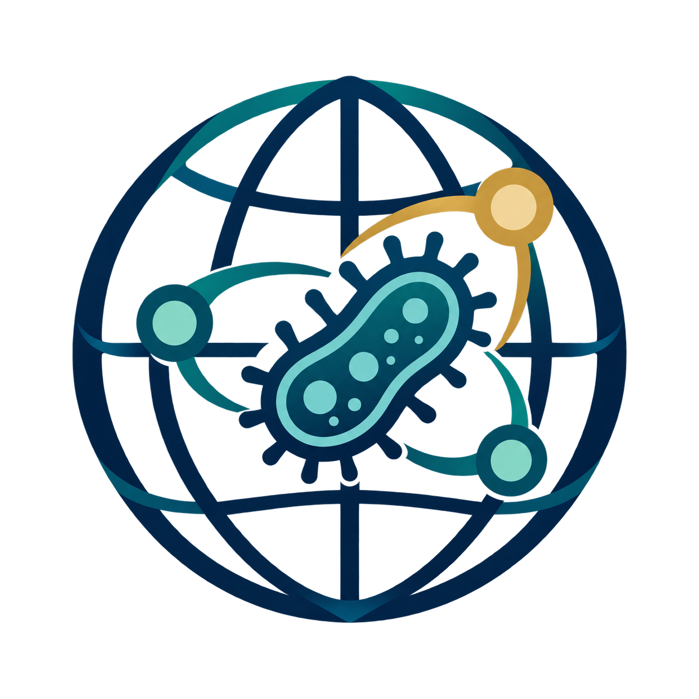

  

# Pathogen Atlas

The Pathogen Atlas is an evidence map of microorganisms reported in connection
with human disease. It brings together literature on named species and
organizes that evidence alongside expert-defined characteristics, so patterns
across organisms can be explored in one place.

[**Explore the Pathogen Atlas**](https://fabriziocosta.github.io/pathogen-atlas-v2/sites/pathogen-atlas-explorer/dist/)

## What the Atlas shows

For each species, the Atlas brings together PubMed search records, abstracts
that were assessed for human disease evidence, and the records that passed the
Atlas evidence threshold. It also summarizes expert questions about properties
such as transmission, reservoirs, clinical presentation, and epidemiology.

The interactive map places each species according to its profile across these
expert-defined characteristics. Color the map by a characteristic or
classification, search for a species or taxonomic group, and select a point to
inspect its taxonomy and supporting PubMed records. Each record links to
PubMed and includes the model confidence used in the Atlas assessment.

The explorer also includes a **Pathogenic index** to summarize the strength of
supporting evidence in the context of how many abstracts were fetched and how
many records the literature search found. Point size can be toggled to show
this index.

## Reading the evidence

The Atlas is intended for exploration and evidence discovery. Its results
reflect the literature found by the searches and the abstracts available for
assessment. A species with little or no evidence in the Atlas should not be
interpreted as proven harmless or incapable of causing disease.

The expert characteristics describe the share of scored abstracts that support
each question. They are not estimates of disease prevalence, incidence, or
severity. Model confidence thresholds determine which records contribute to
the released summaries; they do not replace expert review of the underlying
papers.

## Methods

See [how the species map is computed](https://github.com/fabriziocosta/pathogen-atlas-v2/blob/main/docs/embedding_methodology.md)
for the feature definitions, evidence aggregation, and coordinate calculation.
The [project organization notes](https://github.com/fabriziocosta/pathogen-atlas-v2/blob/main/docs/organization.md)
describe the wider evidence workflow and its outputs.
